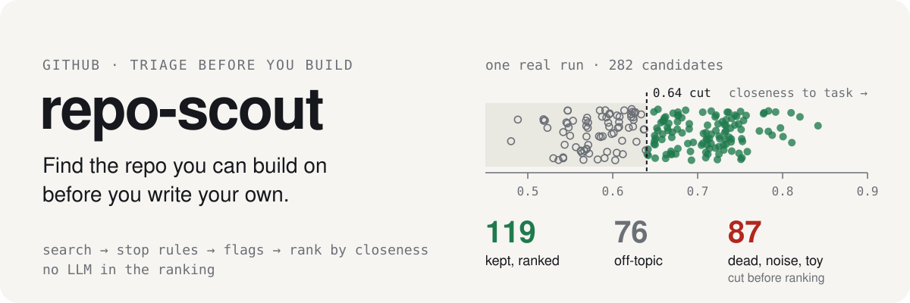
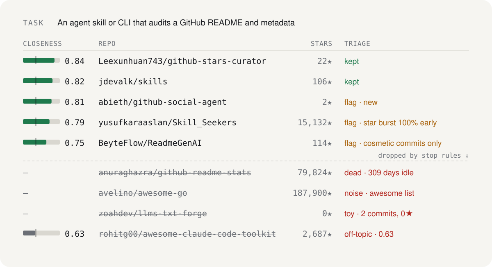

<p align="center">
  
</p>

<p align="center">
  <a href="https://github.com/octrow/repo-scout/actions/workflows/test.yml"></a>
  <a href="LICENSE"></a>
  <a href="https://github.com/octrow/repo-scout/releases/latest"></a>
  
</p>

<p align="center">
  <b>English</b> | <a href="README.ru.md">Русский</a>
</p>

Search GitHub for something you can reuse before you write it yourself. Small new projects count too, because results rank by how close they are to your task.

<p align="center">
  
</p>

repo-scout runs several GitHub searches, merges the results, and does the mechanical first pass of [`docs/repo-triage.md`](docs/repo-triage.md). That pass applies stop rules (dead, toy, noise, no code, off-topic), sets flags (fork, stars ≫ commits, archived, new, template, cosmetic-only commits, star burst), and scores freshness and popularity. Results are sorted by semantic closeness to your task description. A local CPU embedding model computes it, and ranking never calls an LLM.

## Install

Run one command. It installs [uv](https://docs.astral.sh/uv/) (which brings its own Python) and the [GitHub CLI](https://cli.github.com/) if they are missing, then installs the latest [release](https://github.com/octrow/repo-scout/releases). It walks you through `gh auth login` once and downloads the local embedding model. At the end it offers to set up the optional [advanced mode](#basic-and-advanced-mode) and to open the GUI.

```bash
# macOS / Linux
curl -LsSf https://raw.githubusercontent.com/octrow/repo-scout/main/install.sh | sh
```

```powershell
# Windows (PowerShell)
powershell -ExecutionPolicy ByPass -c "irm https://raw.githubusercontent.com/octrow/repo-scout/main/install.ps1 | iex"
```

Run the same command again to update. Options: `sh -s -- --version 0.1.0`, `--main` (current main branch instead of a release), `--no-launch`, `--uninstall` (keeps your runs and index). On Windows set `$env:REPO_SCOUT_VERSION`, `$env:REPO_SCOUT_MAIN=1`, `$env:REPO_SCOUT_NO_LAUNCH=1` or `$env:REPO_SCOUT_UNINSTALL=1` first.

If something does not work, run `repo-scout doctor`. It checks gh, the GitHub login and the model, and tells you how to fix each problem.

### Or download a ready build

Each [release](https://github.com/octrow/repo-scout/releases/latest) has standalone builds that need no Python and no uv. Unpack the archive and run `repo-scout` inside it (on Windows, double-click `repo-scout.exe`). With no arguments it opens the GUI in your browser.

| System | File |
|---|---|
| Windows x64 | `repo-scout-<version>-windows-x86_64.zip` |
| macOS Apple Silicon | `repo-scout-<version>-macos-arm64.tar.gz` |
| Linux x64 (glibc 2.35+, e.g. Ubuntu 22.04+) | `repo-scout-<version>-linux-x86_64.tar.gz` |
| Linux arm64 | `repo-scout-<version>-linux-arm64.tar.gz` |

You still need the [GitHub CLI](https://cli.github.com/), and you need to run `gh auth login` once. `repo-scout doctor --fix` checks this and downloads the model.

The builds are not code-signed. Windows SmartScreen asks you to confirm ("More info" → "Run anyway"). On macOS, a build downloaded in a browser needs `xattr -dr com.apple.quarantine repo-scout` once. On an Intel Mac, use the one-command install.

## Quick start

From a clone, with Python 3.11+, uv and an authenticated `gh`:

```bash
uv sync && uv tool install --editable .   # puts `repo-scout` on PATH
repo-scout --task "Live speech transcription with an overlay, runs on Linux" \
  "whisper live transcription" "speech to text overlay language:python" "topic:asr linux"
repo-scout                                # no arguments: opens the GUI in your browser
```

## How a search works

1. Queries. Each positional argument is a GitHub search query (`language:`, `topic:`, `in:readme`). Write 3-6 variants with synonyms. Leave out `stars:`: a project with few stars can still be the one you need.
2. Round two runs on its own. It builds up to 5 `topic:<slug>` queries from the most common topics in the top 10 (`--round2-k`, `--no-round2`).
3. Index. The local store of past candidates and their READMEs adds its closest matches to the pool (`--from-index N`, default 50). It lives at `~/.local/share/repo-scout/index.db` (`$REPO_SCOUT_INDEX`).
4. Triage applies stop rules and flags. Rows below the closeness threshold (`--min-closeness`, 0.64) are dropped as off-topic. `--all` shows dropped rows as well.
5. Star burst. The top 10 with ≥50★ get a star-history check (`--stars-k`, `--no-stars-check`). The flag shows what share of the first ~1000★ came on burst days. Bought stars and a viral launch look the same, so read the flag as a number and decide yourself.

Hard conditions: `--lang python`, `--must REGEX` (a required word group, repeatable), `--exclude REGEX` (forbidden words). Other options: `--months 6`, `--new-days 60`, `--limit 50`, `--json`. Run `repo-scout --help` for the full list.

## Runs, verdicts and the GUI

Every search is saved as a run in `~/.local/share/repo-scout/runs/<date>-<slug>.json` (`$REPO_SCOUT_RUNS`). Use `--out FILE` to pick the path or `--no-save` to skip saving. Pass `--project P` to tie the run to a project.

```bash
repo-scout verdict owner/repo "→ Study (how the window hides from screen share)" --project P --task "..."
repo-scout gui [--port 8790]   # Search, Runs, Index, Eval
```

A verdict is stored in the Index and shown on later searches. It never hides a repo. The GUI opens saved runs as a filterable table with READMEs from the Index, and you set a verdict in two clicks. Searches and evals run as subprocesses with a live log and a cancel button. The GUI uses a vendored copy of nicegui-kit ([`repo_scout/gui/kit/VENDORED.md`](repo_scout/gui/kit/VENDORED.md)).

Progress goes to stderr and to `~/.local/state/repo-scout/run.log` (`$REPO_SCOUT_LOG`), so you can `tail -f` it from another terminal. Use `-q` to send it only to the log file.

## Basic and advanced mode

Basic mode is the default and needs no API keys. Search, triage, closeness and ranking run on GitHub data and a local CPU model.

Advanced mode adds two optional extras. Each one turns on with its own key. They add information and never drop or reorder results ([ADR 0002](docs/adr/0002-advanced-mode-external-models.md)).

| Extra | What it does | Key | Free option |
|---|---|---|---|
| LLM draft | turns a need written in any language into a task description, queries and hard conditions; you review and run the search yourself | `LLM_API_KEY` | [OmniRoute](https://github.com/diegosouzapw/OmniRoute) (local gateway, the default URL) or [Ollama](https://ollama.com/) (`LLM_BASE_URL=http://localhost:11434/v1`, any key) |
| Fit | Jev, a TypeSafe System One model, rates from 0 to 1 how well each of the top 20 results can serve as the base for your task; shown as a `fit` column next to closeness | `TYPESAFE_API_KEY` | key at [console.typesafe.ai](https://console.typesafe.ai/keys) |

```bash
repo-scout config                                  # asks for the keys, saves ~/.config/repo-scout/.env
repo-scout doctor                                  # shows the mode and what is on
repo-scout draft "<what you need, any language>"   # LLM draft: prints a ready `repo-scout …` command
repo-scout --no-fit ...                            # one search without the fit column
```

| Variable | Default |
|---|---|
| `LLM_API_KEY` | none (LLM draft is off) |
| `LLM_BASE_URL` | `http://127.0.0.1:20128/v1` (any OpenAI-compatible `/chat/completions`) |
| `LLM_MODEL` | `free-stack` |
| `REPO_SCOUT_GUI_DRAFT` | `0`; `1` shows the Draft button in the GUI |
| `TYPESAFE_API_KEY` | none (fit is off) |
| `TYPESAFE_MODEL` | `jev-latest` |

The settings file is `~/.config/repo-scout/.env` (`$REPO_SCOUT_ENV`, readable only by you). Real environment variables take precedence over it. In a clone, a git-ignored `.env` in the repo root works too and overrides the user file. The older `OMNIROUTE_API_KEY`, `OMNIROUTE_MODEL` and `OMNIROUTE_BASE_URL` still work. Replayed runs and evals never call Fit.

## Evaluation

Golden sets in `eval/*.toml` hold a past search plus repos with known verdicts. They replay offline from GitHub snapshots and measure recall ([`eval/README.md`](eval/README.md), [`eval/BASELINE.md`](eval/BASELINE.md)).

```bash
repo-scout eval eval/*.toml [--no-round2] [--calls]      # offline, from snapshots
repo-scout eval eval/*.toml --llm-draft [--record]       # agent queries vs LLM draft vs union
repo-scout eval --fake-stars [--all-grid]                # precision/recall/FPR of the star-burst flag
```

## Agent skill

[`skill/SKILL.md`](skill/SKILL.md) teaches a coding agent the workflow from search to inspection and verdicts. Install it with `ln -s "$PWD/skill" ~/.agents/skills/repo-scout`.

## Development

```bash
uv sync && uv run ruff check . && uv run pytest -q
```

The domain glossary is in [`CONTEXT.md`](CONTEXT.md), and design decisions are in [`docs/adr/`](docs/adr/). See [CONTRIBUTING.md](CONTRIBUTING.md) before a pull request; report vulnerabilities as described in [SECURITY.md](SECURITY.md).

## License

[MIT](LICENSE). Third-party code, data and fonts are listed in [`THIRD_PARTY_NOTICES.md`](THIRD_PARTY_NOTICES.md).
