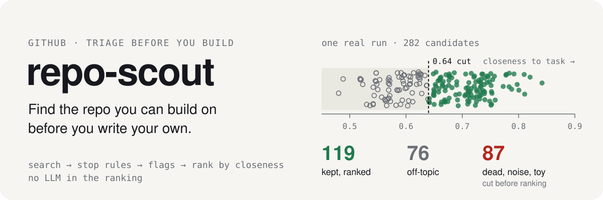
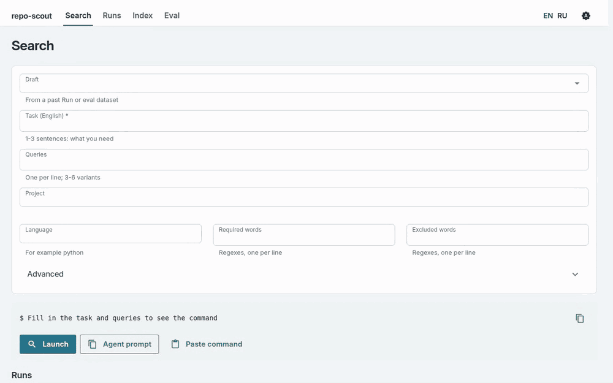
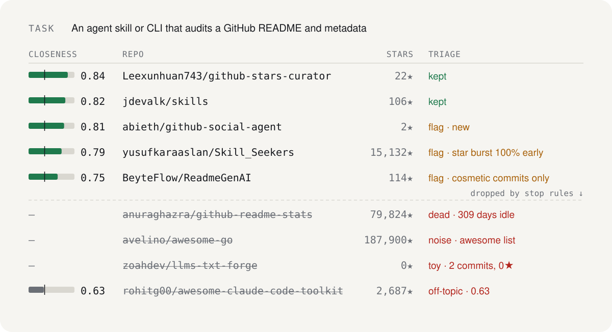
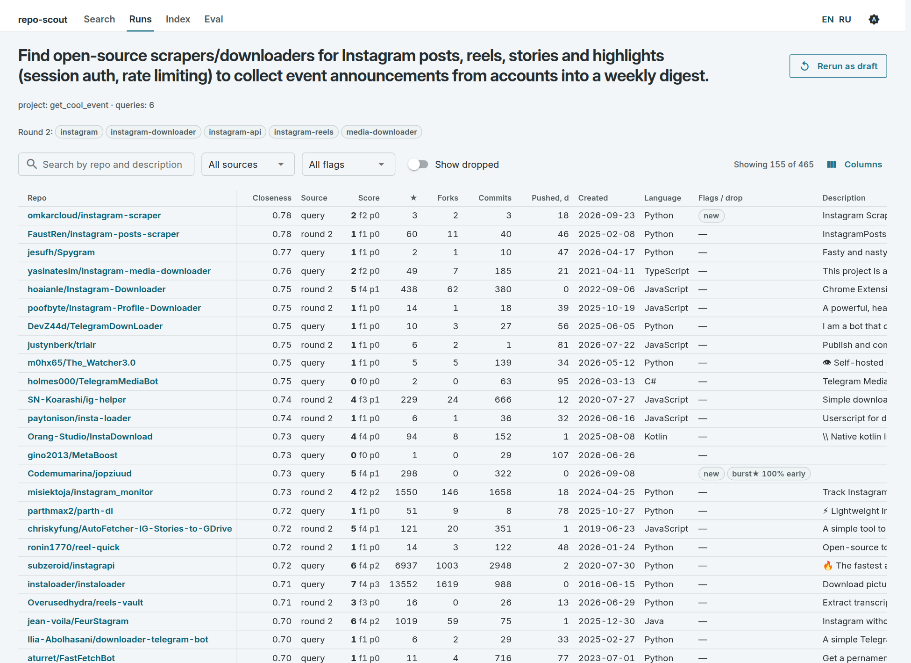
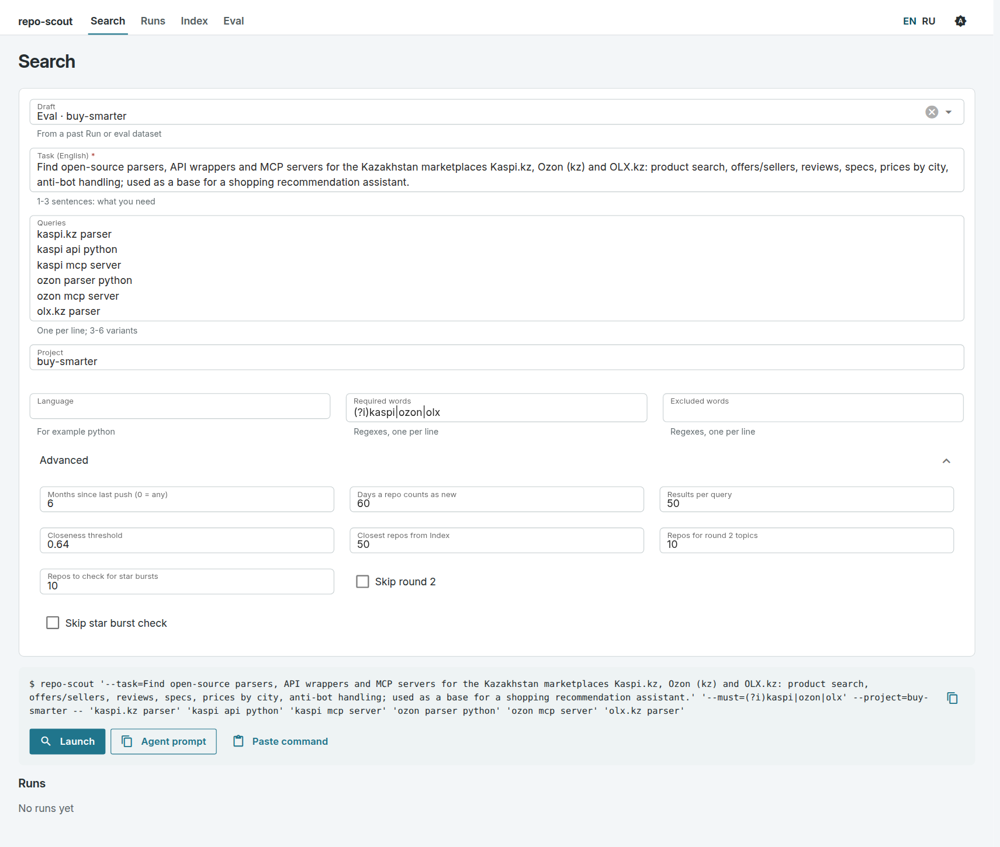
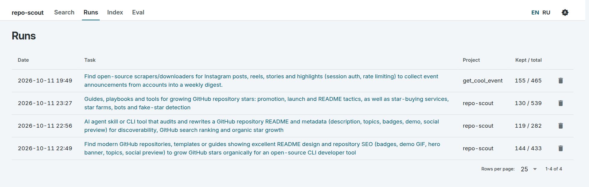
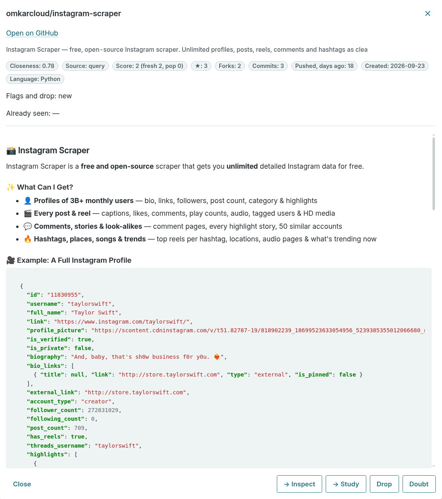
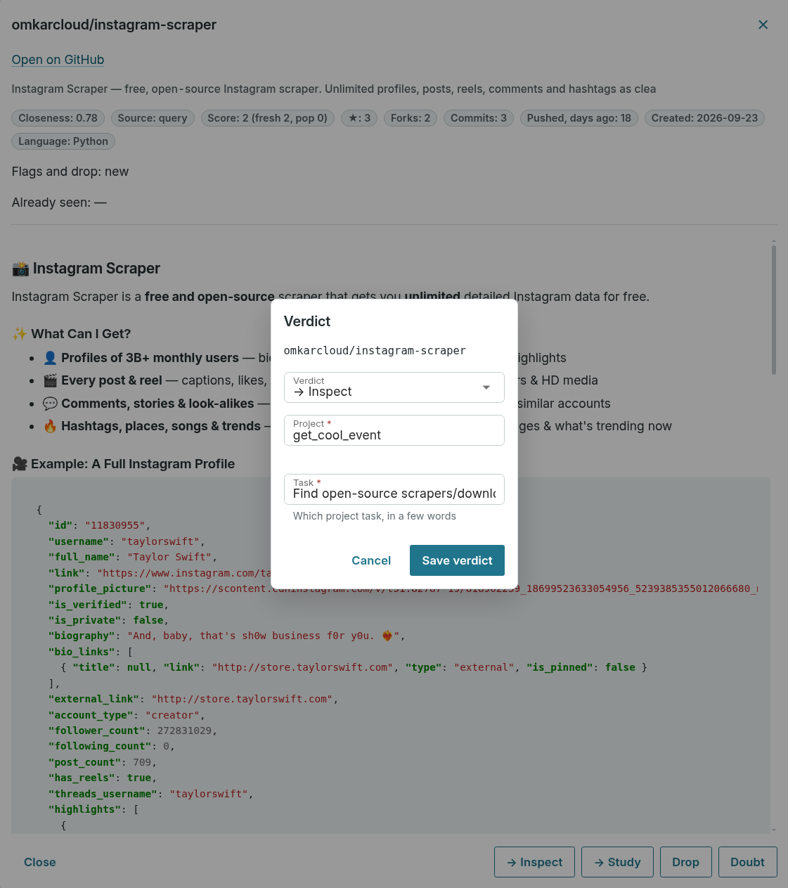
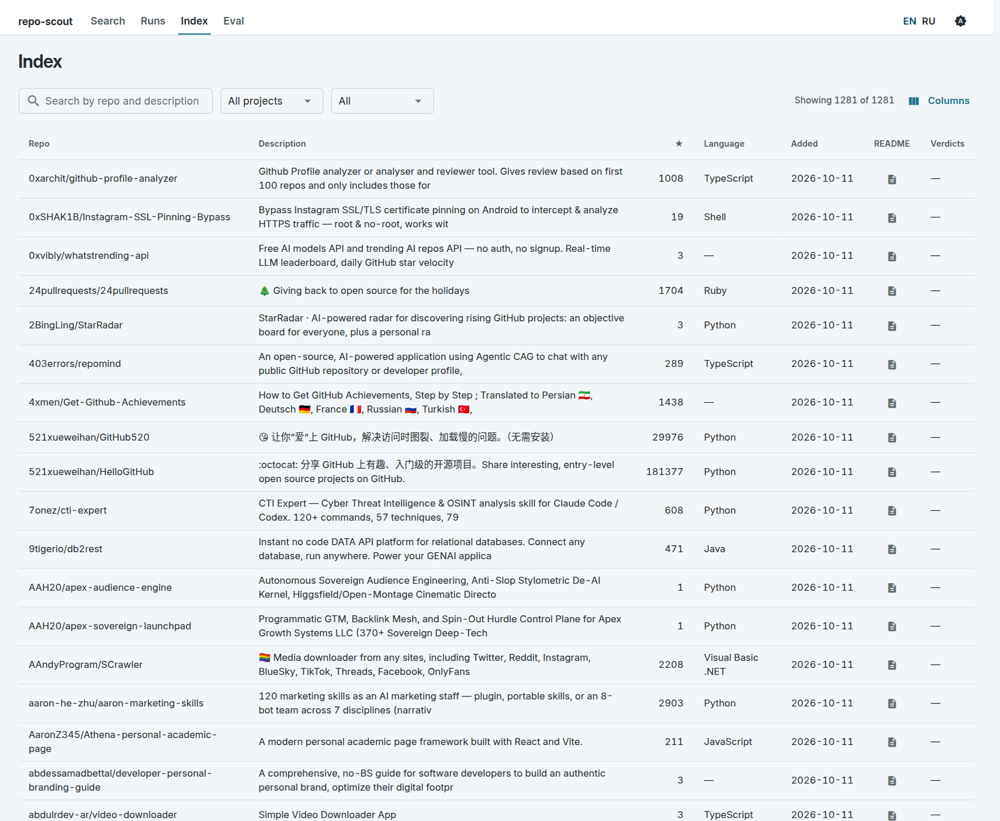
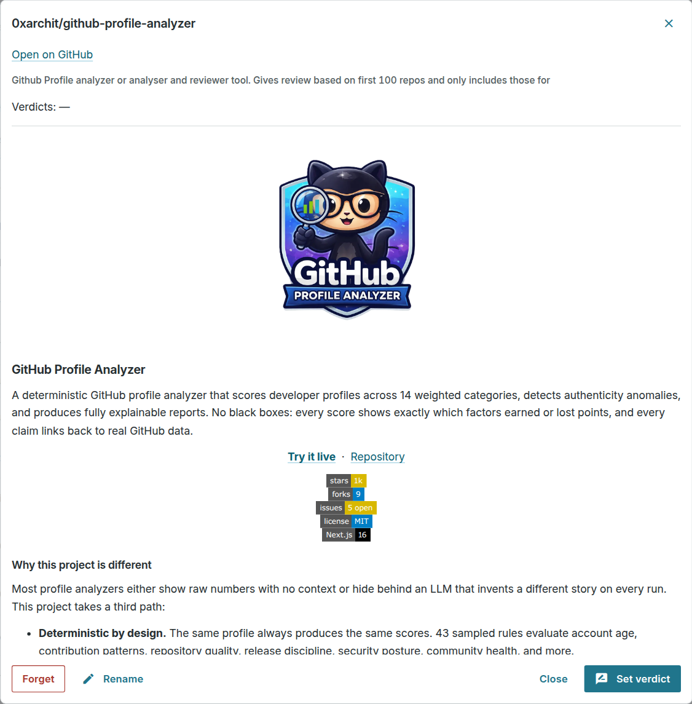

<p align="center">
  
</p>

<p align="center">
  <a href="https://github.com/octrow/repo-scout/actions/workflows/test.yml"></a>
  <a href="LICENSE"></a>
  <a href="https://github.com/octrow/repo-scout/releases/latest"></a>
  
</p>

<p align="center">
  <b>English</b> | <a href="README.ru.md">Русский</a>
</p>

Find a GitHub repo to build on before you write your own. Small new projects count too: results rank by how close they are to your task.

<p align="center">
  
</p>

<p align="center">
  
</p>

repo-scout runs several GitHub searches, merges the results, and does the mechanical first pass of [`docs/repo-triage.md`](docs/repo-triage.md).

- Stop rules drop dead, toy, noise, no-code and off-topic repos.
- Flags mark forks, archived repos, new repos, templates, cosmetic-only commits and star bursts.
- Results sort by closeness to your task. A local CPU model computes it, and ranking never calls an LLM.

## Install

Run one command. It installs [uv](https://docs.astral.sh/uv/) and the [GitHub CLI](https://cli.github.com/) if they are missing, then installs the latest [release](https://github.com/octrow/repo-scout/releases).

```bash
# macOS / Linux
curl -LsSf https://raw.githubusercontent.com/octrow/repo-scout/main/install.sh | sh
```

```powershell
# Windows (PowerShell)
powershell -ExecutionPolicy ByPass -c "irm https://raw.githubusercontent.com/octrow/repo-scout/main/install.ps1 | iex"
```

It walks you through `gh auth login` once and downloads the local model. At the end it offers the optional [advanced mode](#basic-and-advanced-mode) and the GUI.

repo-scout is not on PyPI: `pip install repo-scout` installs an unrelated project. Something broken? Run `repo-scout doctor`.

Ready builds without Python, installer options and a clone install: [`docs/install.md`](docs/install.md).

## Quick start

With the install done, run a search or open the GUI:

```bash
repo-scout --task "Live speech transcription with an overlay, runs on Linux" \
  "whisper live transcription" "speech to text overlay language:python" "topic:asr linux"
repo-scout                                # no arguments: opens the GUI in your browser
```

## How a search works

1. Queries. Each argument is a GitHub search query. Write 3-6 variants with synonyms.
2. Round two runs on its own and adds `topic:` queries from the top 10.
3. The Index of past candidates adds its closest matches.
4. Triage applies stop rules and flags. Rows below the closeness threshold (0.64) are dropped as off-topic.
5. Star burst: the top 10 with 50+ stars get a star-history check. Read the flag as a number and decide yourself.

Options, hard conditions (`--lang`, `--must`, `--exclude`) and defaults: [`docs/usage.md`](docs/usage.md) and `repo-scout --help`. Step-by-step code flow: [`docs/logic-map.md`](docs/logic-map.md).

How it differs from GitHub search, DeepGit, repohunt and others: [`docs/comparison.md`](docs/comparison.md).

## Runs, verdicts and the GUI

Every search is saved as a run. A verdict you set on a repo is stored in the Index and shown on later searches. It never hides a repo.

```bash
repo-scout verdict owner/repo "→ Study (how the window hides from screen share)" --project P --task "..."
repo-scout gui [--port 8790]   # Search, Runs, Index, Eval
```

The GUI opens saved runs as a filterable table with READMEs from the Index, and you set a verdict in two clicks. Searches and evals run with a live log and a cancel button. The GUI uses a vendored copy of nicegui-kit ([`repo_scout/gui/kit/VENDORED.md`](repo_scout/gui/kit/VENDORED.md)).

The GUI is in English by default. Switch to Russian with EN | RU in the header.

Run files, log file and `--out`, `--no-save`, `-q`: [`docs/usage.md`](docs/usage.md).

<p align="center">
  
</p>

<details>
<summary>More screenshots</summary>

Search form, filled from an eval set:



Saved runs:



Repo card with its README, and a verdict:

 

Index of past candidates:





</details>

## Basic and advanced mode

Basic mode is the default and needs no API keys. Search, triage and ranking run on GitHub data and a local CPU model.

Advanced mode adds two optional extras, each with its own key. They never drop or reorder results.

- LLM draft turns a need in any language into a task, queries and conditions. Key: `LLM_API_KEY`.
- Fit rates how well each of the top 20 results can be your base. Key: `TYPESAFE_API_KEY`.

Run `repo-scout config` to set the keys. Free options, variables and defaults: [`docs/advanced-mode.md`](docs/advanced-mode.md).

## Evaluation

Golden sets in `eval/*.toml` replay past searches offline and measure recall. Commands: [`docs/usage.md`](docs/usage.md#evaluation).

## Agent skill

[`skill/SKILL.md`](skill/SKILL.md) teaches a coding agent the workflow from search to inspection and verdicts. Install it with `ln -s "$PWD/skill" ~/.agents/skills/repo-scout`.

## Development

```bash
uv sync && uv run ruff check . && uv run pytest -q
```

Domain glossary: [`CONTEXT.md`](CONTEXT.md). Design decisions: [`docs/adr/`](docs/adr/). Read [CONTRIBUTING.md](CONTRIBUTING.md) before a pull request. Report vulnerabilities as described in [SECURITY.md](SECURITY.md). How this repo was prepared for publishing: [`docs/usage.md`](docs/usage.md#publishing).

## License

[MIT](LICENSE). Third-party code, data and fonts are listed in [`THIRD_PARTY_NOTICES.md`](THIRD_PARTY_NOTICES.md).
