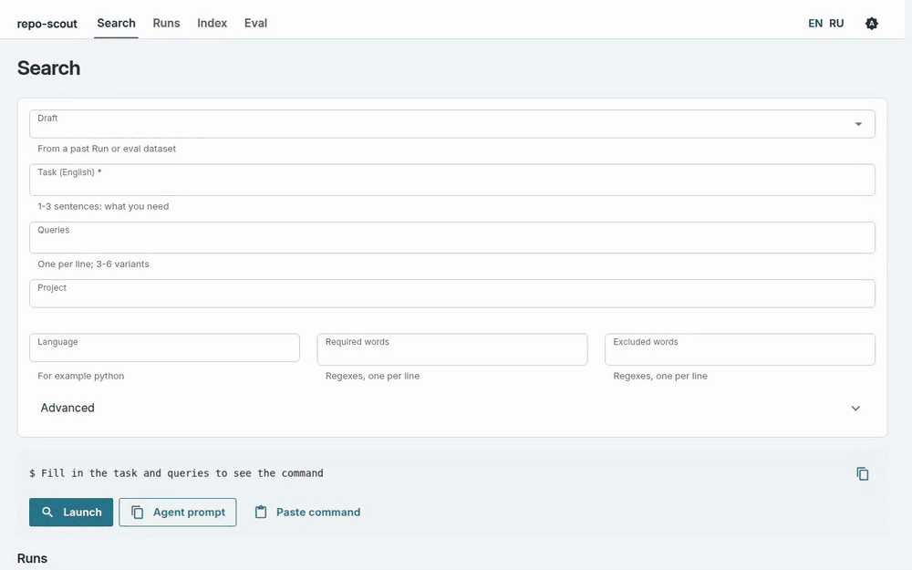
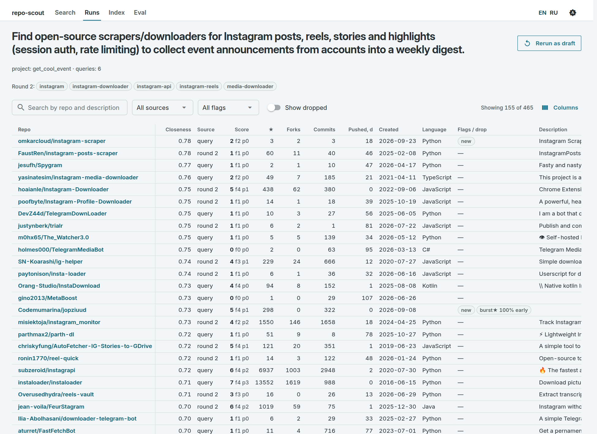
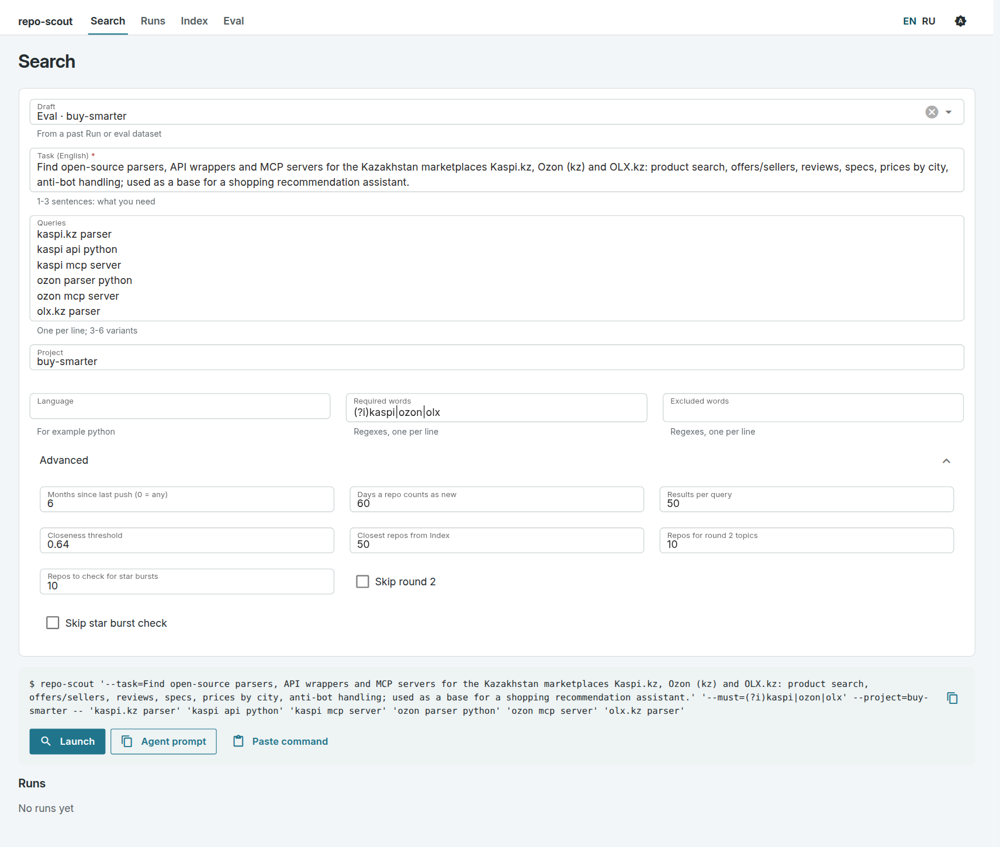
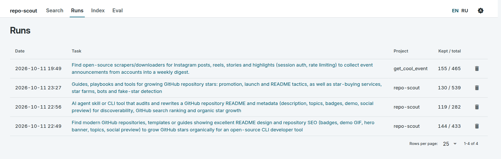
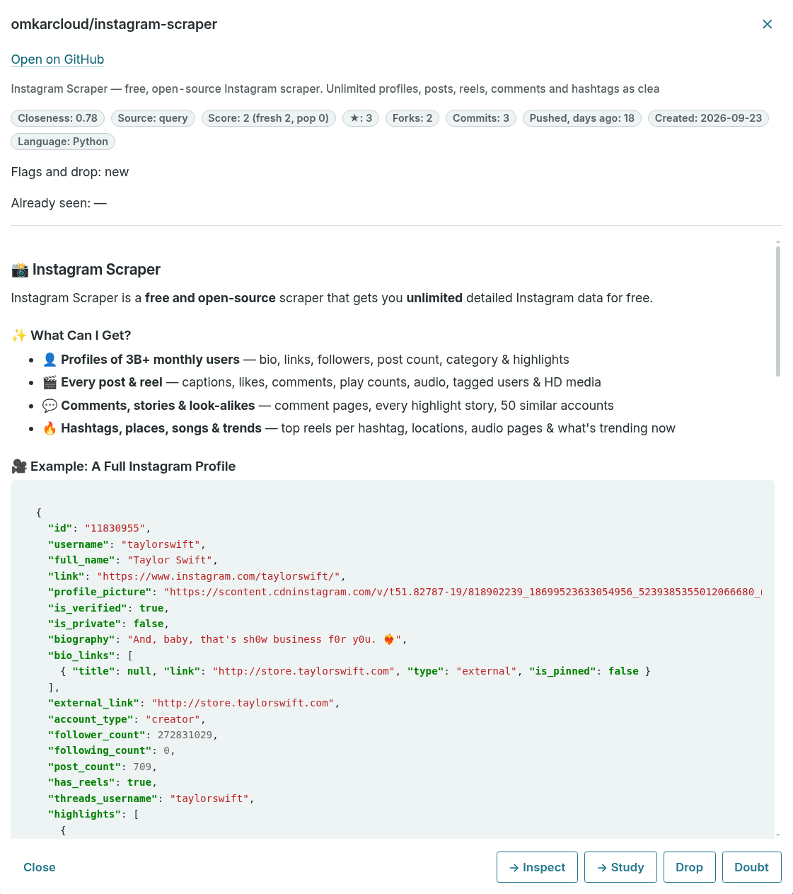
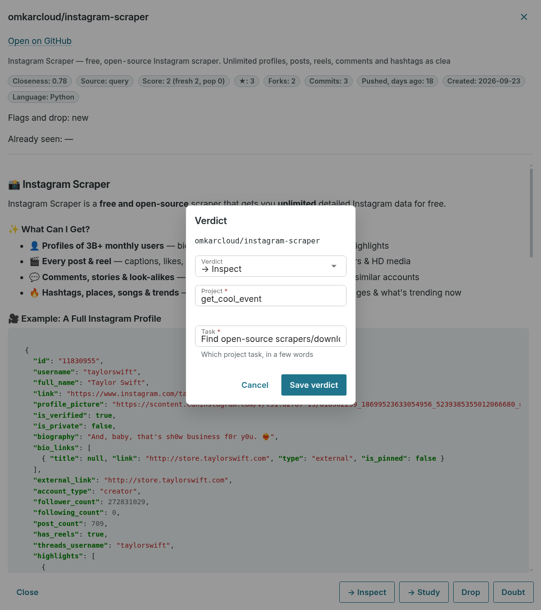
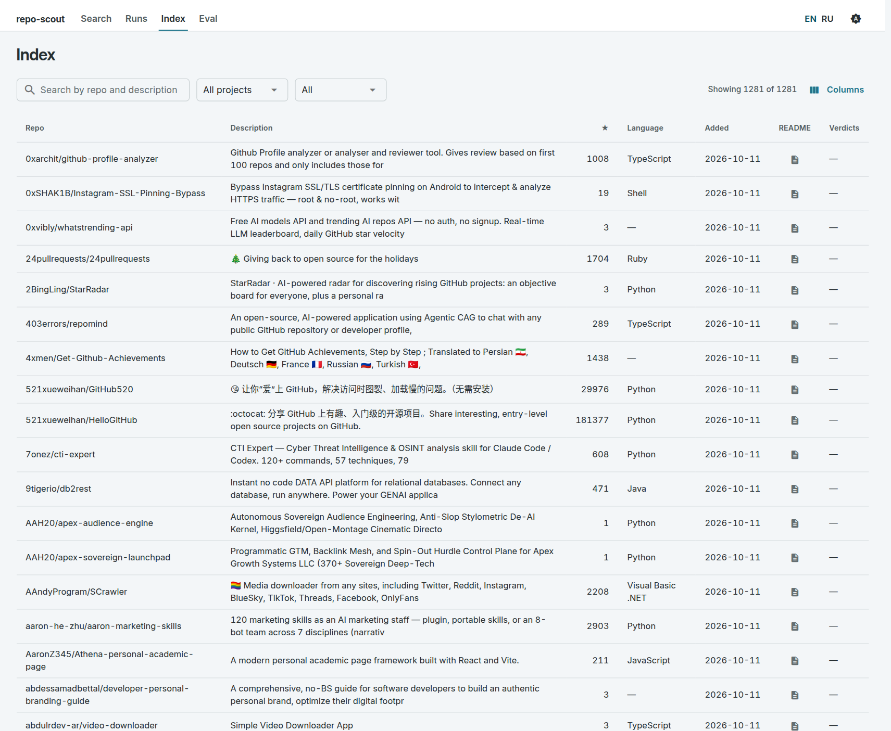
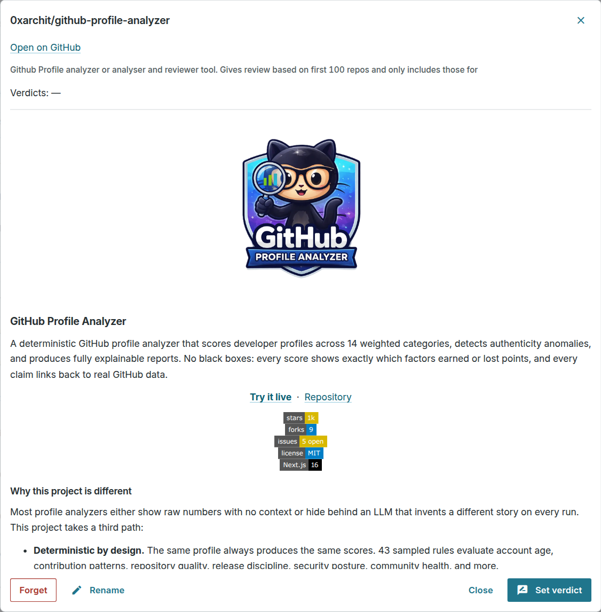

<p align="center">
  
</p>

<p align="center">
  <a href="https://github.com/octrow/repo-scout/actions/workflows/test.yml"></a>
  <a href="LICENSE"></a>
  <a href="https://github.com/octrow/repo-scout/releases/latest"></a>
  
</p>

<p align="center">
  <a href="README.md">English</a> | <b>Русский</b>
</p>

Найдите на GitHub готовое решение, прежде чем писать своё. Небольшие новые проекты тоже попадают в выдачу: результаты сортируются по смысловой близости к вашей задаче.

<p align="center">
  
</p>

<p align="center">
  
</p>

repo-scout делает несколько поисковых запросов к GitHub, объединяет результаты и проводит первый механический отбор по [`docs/repo-triage.ru.md`](docs/repo-triage.ru.md). Отбор применяет стоп-правила (мёртвый, игрушка, шум, нет кода, не по теме), ставит флаги (форк, звёзды ≫ коммиты, архивный, новый, шаблон, только косметика, всплеск звёзд) и считает баллы свежести и популярности. Результаты сортируются по смысловой близости к описанию задачи. Близость считает локальная CPU-модель эмбеддингов, LLM при ранжировании не вызывается.

## Установка

Запустите одну команду. Она ставит [uv](https://docs.astral.sh/uv/) (он сам скачает Python) и [GitHub CLI](https://cli.github.com/), если их нет, и устанавливает последний [релиз](https://github.com/octrow/repo-scout/releases). Затем один раз проводит через `gh auth login` и скачивает локальную модель эмбеддингов. В конце предлагает настроить необязательный [продвинутый режим](#базовый-и-продвинутый-режим) и открыть GUI.

```bash
# macOS / Linux
curl -LsSf https://raw.githubusercontent.com/octrow/repo-scout/main/install.sh | sh
```

```powershell
# Windows (PowerShell)
powershell -ExecutionPolicy ByPass -c "irm https://raw.githubusercontent.com/octrow/repo-scout/main/install.ps1 | iex"
```

Чтобы обновиться, запустите ту же команду ещё раз. Опции: `sh -s -- --version 0.1.0`, `--main` (текущая ветка main вместо релиза), `--no-launch`, `--uninstall` (прогоны и индекс остаются). В Windows перед запуском задайте `$env:REPO_SCOUT_VERSION`, `$env:REPO_SCOUT_MAIN=1`, `$env:REPO_SCOUT_NO_LAUNCH=1` или `$env:REPO_SCOUT_UNINSTALL=1`.

Если что-то не работает, запустите `repo-scout doctor`. Он проверит gh, вход в GitHub и модель и подскажет, как исправить каждую проблему.

### Или скачайте готовую сборку

В каждом [релизе](https://github.com/octrow/repo-scout/releases/latest) есть автономные сборки, которым не нужны Python и uv. Распакуйте архив и запустите `repo-scout` внутри него (в Windows дважды щёлкните `repo-scout.exe`). Без аргументов он открывает GUI в браузере.

| Система | Файл |
|---|---|
| Windows x64 | `repo-scout-<версия>-windows-x86_64.zip` |
| macOS Apple Silicon | `repo-scout-<версия>-macos-arm64.tar.gz` |
| Linux x64 (glibc 2.35+, например Ubuntu 22.04+) | `repo-scout-<версия>-linux-x86_64.tar.gz` |
| Linux arm64 | `repo-scout-<версия>-linux-arm64.tar.gz` |

[GitHub CLI](https://cli.github.com/) всё равно нужен, и `gh auth login` нужно один раз выполнить. `repo-scout doctor --fix` проверит это и скачает модель.

Сборки не подписаны. Windows SmartScreen попросит подтвердить запуск («Подробнее» → «Выполнить в любом случае»). На macOS сборке, скачанной через браузер, один раз нужен `xattr -dr com.apple.quarantine repo-scout`. На Mac с Intel используйте установку одной командой.

## Быстрый старт

Из клона, если есть Python 3.11+, uv и `gh` с выполненным входом:

```bash
uv sync && uv tool install --editable .   # добавляет repo-scout в PATH
repo-scout --task "Live speech transcription with an overlay, runs on Linux" \
  "whisper live transcription" "speech to text overlay language:python" "topic:asr linux"
repo-scout                                # без аргументов: открывает GUI в браузере
```

## Как работает поиск

1. Запросы. Каждый позиционный аргумент - поисковый запрос к GitHub (`language:`, `topic:`, `in:readme`). Напишите 3-6 вариантов с синонимами. Не добавляйте `stars:`: проект с малым числом звёзд тоже может подойти.
2. Второй круг запускается сам. Он строит до 5 запросов `topic:<slug>` из самых частых тем в первой десятке (`--round2-k`, `--no-round2`).
3. Индекс. Локальное хранилище прошлых кандидатов и их README добавляет ближайшие совпадения в пул (`--from-index N`, по умолчанию 50). База лежит в `~/.local/share/repo-scout/index.db` (`$REPO_SCOUT_INDEX`).
4. Отбор (Triage) применяет стоп-правила и флаги. Строки ниже порога близости (`--min-closeness`, 0.64) отсеиваются как не по теме. `--all` показывает и отсеянные строки.
5. Всплеск звёзд. Первая десятка с ≥50★ проверяется по истории звёзд (`--stars-k`, `--no-stars-check`). Флаг показывает, какая доля первых ~1000★ пришла в пиковые дни. Накрутка и вирусный запуск выглядят одинаково, поэтому флаг - это число, решение за вами.

Жёсткие условия: `--lang python`, `--must REGEX` (обязательная группа слов, можно повторять), `--exclude REGEX` (запрещённые слова). Другие опции: `--months 6`, `--new-days 60`, `--limit 50`, `--json`. Полный список: `repo-scout --help`.

## Чем отличается от поиска GitHub и похожих инструментов

| Инструмент | Что делает хорошо | Чем отличается repo-scout |
|---|---|---|
| Поиск GitHub | Один запрос, сортировка по совпадению или звёздам | Запускает несколько запросов и объединяет их, отсекает заброшенные, игрушечные и нерелевантные репозитории и сортирует по близости к задаче, а не по звёздам |
| Спросить чат-модель | Быстрые подсказки обычным языком | Каждый кандидат берётся из живого поиска GitHub, поэтому новые репозитории попадают в выдачу, а несуществующих названий нет |
| [DeepGit](https://github.com/zamalali/DeepGit) | LLM составляет план поиска и ранжирует короткий список | Ранжирование без LLM и без API-ключа; правила отсева и флаги детерминированы, одни и те же кандидаты всегда получают одни и те же отметки |
| [repohunt](https://github.com/danielrltan/repohunt) | MCP-сервер, который ищет и ранжирует результаты для агента | Добавляет локальную модель эмбеддингов для близости, правила отсева, проверку всплеска звёзд и локальный Индекс с вашими вердиктами |
| [github-hidden-gems](https://github.com/JoanAbad82/github-hidden-gems) | Оценивает, насколько хорош малоизвестный репозиторий (0–100) | Оценивает, насколько репозиторий близок к *вашей* задаче, и сохраняет вердикт по проекту |

Разбор этих инструментов в [`docs/analogs/`](docs/analogs/README.ru.md); часть идей взята оттуда.

## Прогоны, вердикты и GUI

Каждый поиск сохраняется как прогон в `~/.local/share/repo-scout/runs/<date>-<slug>.json` (`$REPO_SCOUT_RUNS`). `--out FILE` задаёт путь, `--no-save` отключает сохранение. `--project P` привязывает прогон к проекту.

```bash
repo-scout verdict owner/repo "→ Разбор (как окно скрывается от захвата экрана)" --project P --task "..."
repo-scout gui [--port 8790]   # Поиск, Прогоны, Индекс, Eval
```

Вердикт сохраняется в Индексе и показывается в следующих поисках. Репозиторий он никогда не скрывает. GUI открывает сохранённые прогоны таблицей с фильтрами и README из Индекса, вердикт ставится в два клика. Поиски и eval запускаются в подпроцессах с живым логом и кнопкой отмены. GUI использует встроенную копию nicegui-kit ([`repo_scout/gui/kit/VENDORED.ru.md`](repo_scout/gui/kit/VENDORED.ru.md)).

GUI по умолчанию на английском. Переключите на русский кнопками EN | RU в шапке; выбор сохраняется как `REPO_SCOUT_LANG` в `~/.config/repo-scout/.env`.

<p align="center">
  
</p>

<details>
<summary>Ещё скриншоты</summary>

Форма поиска, заполненная из набора eval:



Сохранённые прогоны:



Карточка репозитория с README и вердикт:

 

Индекс прошлых кандидатов:





</details>

Ход работы пишется в stderr и в `~/.local/state/repo-scout/run.log` (`$REPO_SCOUT_LOG`), так что его можно смотреть через `tail -f` из другого терминала. С `-q` он пишется только в файл лога.

## Базовый и продвинутый режим

Базовый режим включён по умолчанию и не требует API-ключей. Поиск, отсев, близость и ранжирование работают на данных GitHub и локальной CPU-модели.

Продвинутый режим добавляет два необязательных дополнения. Каждое включается своим ключом. Они добавляют информацию и никогда не отбрасывают и не переупорядочивают результаты ([ADR 0002](docs/adr/0002-advanced-mode-external-models.ru.md)).

| Дополнение | Что делает | Ключ | Бесплатный вариант |
|---|---|---|---|
| Черновик LLM | превращает потребность на любом языке в описание задачи, запросы и жёсткие условия; вы проверяете и сами запускаете поиск | `LLM_API_KEY` | [OmniRoute](https://github.com/diegosouzapw/OmniRoute) (локальный шлюз, адрес по умолчанию) или [Ollama](https://ollama.com/) (`LLM_BASE_URL=http://localhost:11434/v1`, любой ключ) |
| Пригодность (fit) | Jev, модель System One от TypeSafe, оценивает от 0 до 1, насколько каждый из 20 верхних результатов годится как основа для задачи; колонка `fit` рядом с близостью | `TYPESAFE_API_KEY` | ключ на [console.typesafe.ai](https://console.typesafe.ai/keys) |

```bash
repo-scout config                                     # спрашивает ключи, сохраняет ~/.config/repo-scout/.env
repo-scout doctor                                     # показывает режим и что включено
repo-scout draft "<что нужно найти на любом языке>"   # Черновик LLM: выводит готовую команду `repo-scout …`
repo-scout --no-fit ...                               # один поиск без колонки fit
```

| Переменная | По умолчанию |
|---|---|
| `LLM_API_KEY` | не задана (Черновик выключен) |
| `LLM_BASE_URL` | `http://127.0.0.1:20128/v1` (любой OpenAI-совместимый `/chat/completions`) |
| `LLM_MODEL` | `free-stack` |
| `REPO_SCOUT_GUI_DRAFT` | `0`; `1` показывает кнопку «Черновик» в GUI |
| `TYPESAFE_API_KEY` | не задана (fit выключен) |
| `TYPESAFE_MODEL` | `jev-latest` |

Файл настроек: `~/.config/repo-scout/.env` (`$REPO_SCOUT_ENV`, доступен только вам). Настоящие переменные окружения важнее файла. В клоне работает и `.env` в корне репозитория (в `.gitignore`), он переопределяет пользовательский файл. Старые `OMNIROUTE_API_KEY`, `OMNIROUTE_MODEL` и `OMNIROUTE_BASE_URL` продолжают работать. Воспроизведённые прогоны и eval никогда не вызывают fit.

## Оценка качества (Eval)

Эталонные наборы в `eval/*.toml` содержат прошлый поиск и репозитории с известными вердиктами. Они воспроизводятся офлайн из снапшотов GitHub и измеряют полноту выдачи ([`eval/README.ru.md`](eval/README.ru.md), [`eval/BASELINE.ru.md`](eval/BASELINE.ru.md)).

```bash
repo-scout eval eval/*.toml [--no-round2] [--calls]      # офлайн, из снапшотов
repo-scout eval eval/*.toml --llm-draft [--record]       # запросы агента vs черновик LLM vs объединение
repo-scout eval --fake-stars [--all-grid]                # точность/полнота/FPR флага всплеска звёзд
```

## Агентский навык (Skill)

[`skill/SKILL.ru.md`](skill/SKILL.ru.md) учит AI-агента рабочему процессу от поиска до осмотра и вердиктов. Установка: `ln -s "$PWD/skill" ~/.agents/skills/repo-scout`.

## Разработка

```bash
uv sync && uv run ruff check . && uv run pytest -q
```

Глоссарий предметной области лежит в [`CONTEXT.ru.md`](CONTEXT.ru.md), архитектурные решения - в [`docs/adr/`](docs/adr/). Перед pull request прочитайте [CONTRIBUTING.ru.md](CONTRIBUTING.ru.md), об уязвимостях сообщайте по [SECURITY.ru.md](SECURITY.ru.md).

## Лицензия

[MIT](LICENSE). Сторонний код, данные и шрифты перечислены в [`THIRD_PARTY_NOTICES.md`](THIRD_PARTY_NOTICES.md).
