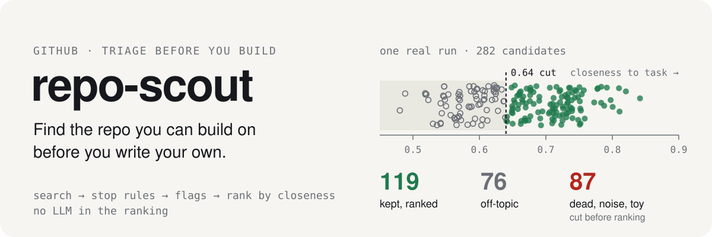
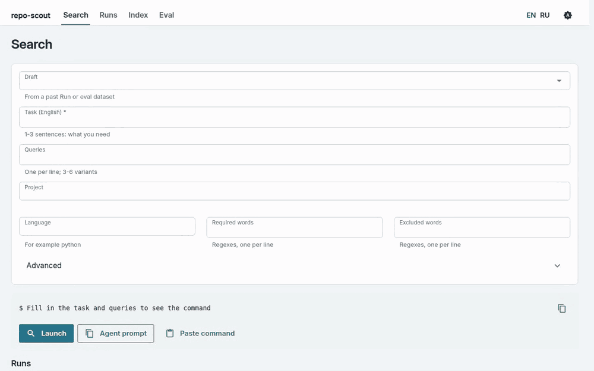
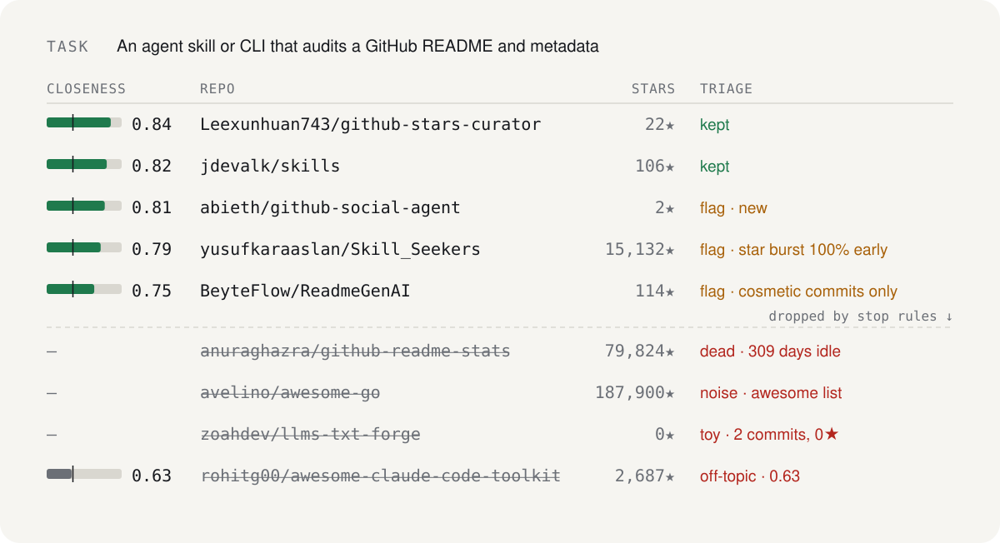
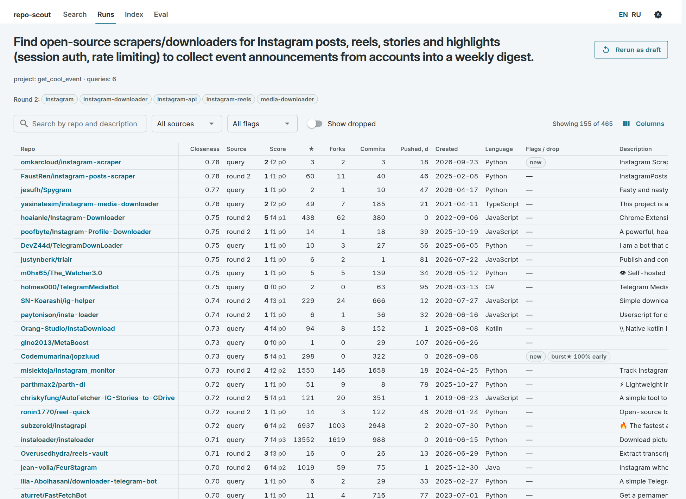
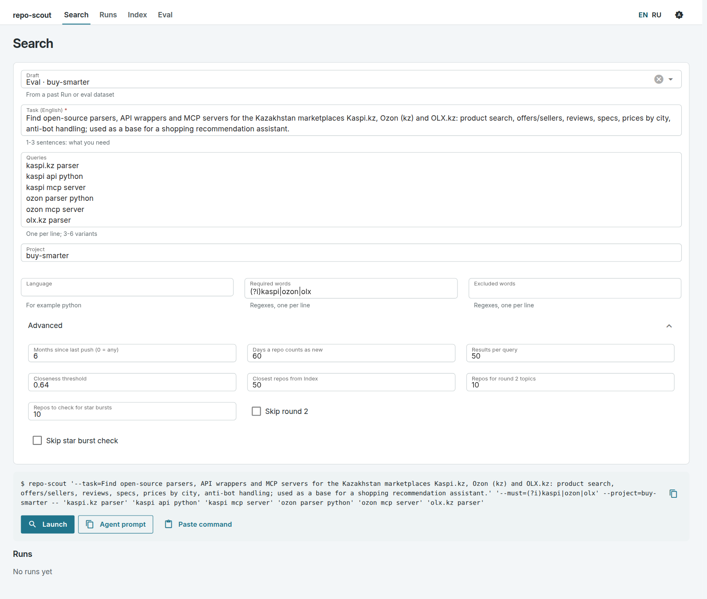
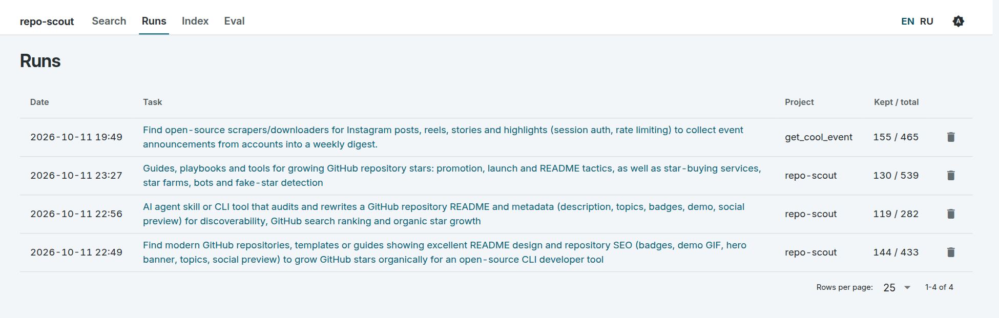
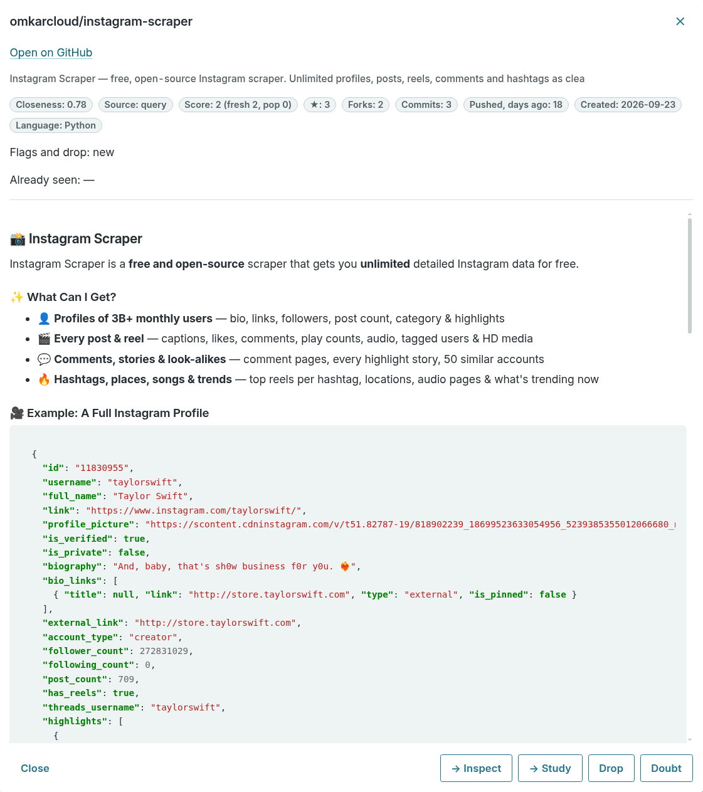
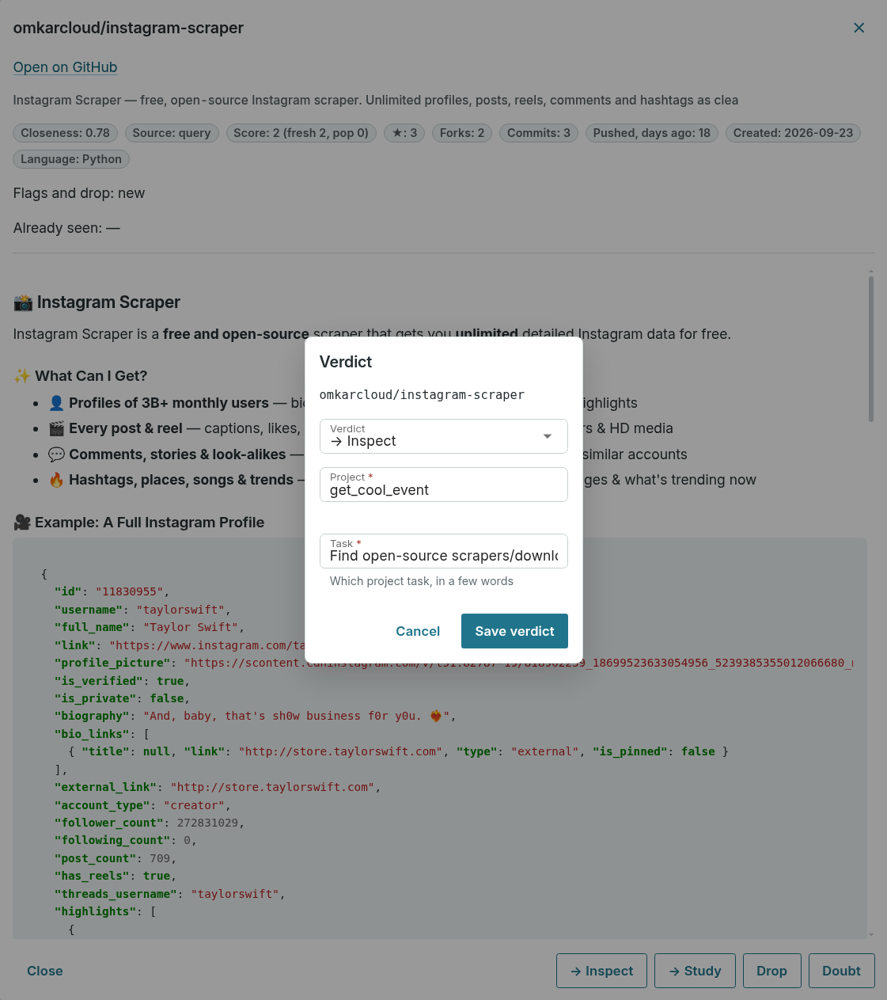
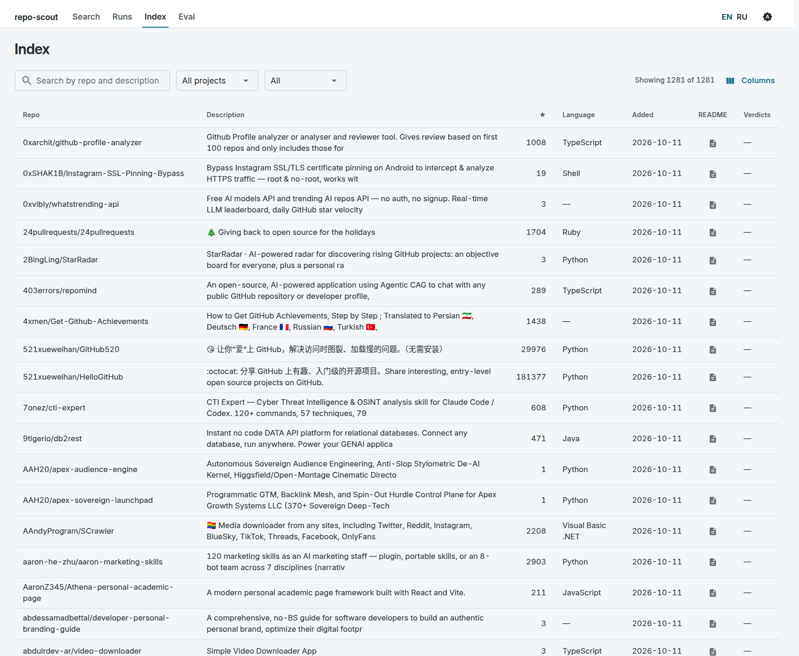
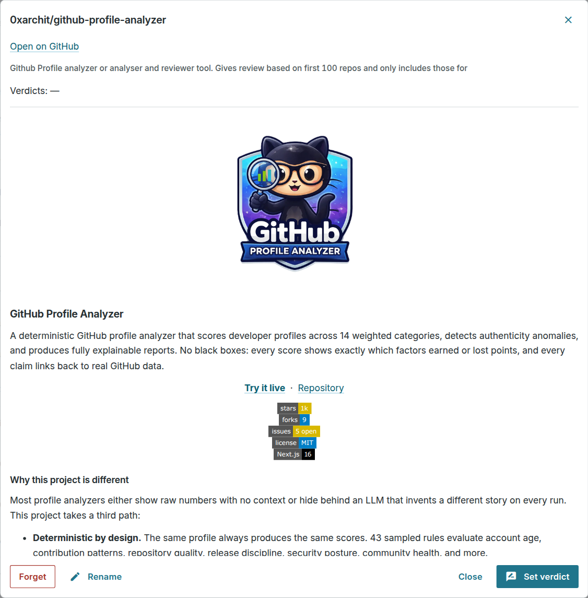

<p align="center">
  
</p>

<p align="center">
  <a href="https://github.com/octrow/repo-scout/actions/workflows/test.yml"></a>
  <a href="LICENSE"></a>
  <a href="https://github.com/octrow/repo-scout/releases/latest"></a>
  
</p>

<p align="center">
  <a href="README.md">English</a> | <b>Русский</b>
</p>

Найдите на GitHub репозиторий, на базе которого можно строить, прежде чем писать своё. Небольшие новые проекты тоже попадают в выдачу: результаты сортируются по близости к вашей задаче.

<p align="center">
  
</p>

<p align="center">
  
</p>

repo-scout делает несколько поисковых запросов к GitHub, объединяет результаты и проводит первый механический отбор по [`docs/repo-triage.ru.md`](docs/repo-triage.ru.md).

- Стоп-правила отсекают мёртвые, игрушечные, шумные репозитории, репозитории без кода и не по теме.
- Флаги отмечают форки, архивные, новые, шаблоны, только косметические коммиты и всплески звёзд.
- Результаты сортируются по близости к задаче. Её считает локальная CPU-модель, LLM при ранжировании не вызывается.

## Установка

Запустите одну команду. Она ставит [uv](https://docs.astral.sh/uv/) и [GitHub CLI](https://cli.github.com/), если их нет, и устанавливает последний [релиз](https://github.com/octrow/repo-scout/releases).

```bash
# macOS / Linux
curl -LsSf https://raw.githubusercontent.com/octrow/repo-scout/main/install.sh | sh
```

```powershell
# Windows (PowerShell)
powershell -ExecutionPolicy ByPass -c "irm https://raw.githubusercontent.com/octrow/repo-scout/main/install.ps1 | iex"
```

Один раз проведёт через `gh auth login` и скачает локальную модель. В конце предложит необязательный [продвинутый режим](#базовый-и-продвинутый-режим) и GUI.

На PyPI repo-scout нет: `pip install repo-scout` поставит чужой проект. Что-то не работает? Запустите `repo-scout doctor`.

Готовые сборки без Python, опции установщика и установка из клона: [`docs/install.ru.md`](docs/install.ru.md).

## Быстрый старт

После установки запустите поиск или откройте GUI:

```bash
repo-scout --task "Live speech transcription with an overlay, runs on Linux" \
  "whisper live transcription" "speech to text overlay language:python" "topic:asr linux"
repo-scout                                # без аргументов: открывает GUI в браузере
```

## Как работает поиск

1. Запросы. Каждый аргумент - поисковый запрос к GitHub. Напишите 3-6 вариантов с синонимами.
2. Второй круг запускается сам и добавляет запросы `topic:` из первой десятки.
3. Индекс прошлых кандидатов добавляет ближайшие совпадения.
4. Отбор (Triage) применяет стоп-правила и флаги. Строки ниже порога близости (0.64) отсеиваются как не по теме.
5. Всплеск звёзд: первая десятка с 50+ звёздами проверяется по истории звёзд. Флаг - это число, решение за вами.

Опции, жёсткие условия (`--lang`, `--must`, `--exclude`) и значения по умолчанию: [`docs/usage.ru.md`](docs/usage.ru.md) и `repo-scout --help`. Ход работы кода по шагам: [`docs/logic-map.md`](docs/logic-map.md).

Чем отличается от поиска GitHub, DeepGit, repohunt и других: [`docs/comparison.ru.md`](docs/comparison.ru.md).

## Прогоны, вердикты и GUI

Каждый поиск сохраняется как прогон. Вердикт по репозиторию сохраняется в Индексе и показывается в следующих поисках. Репозиторий он никогда не скрывает.

```bash
repo-scout verdict owner/repo "→ Разбор (как окно скрывается от захвата экрана)" --project P --task "..."
repo-scout gui [--port 8790]   # Поиск, Прогоны, Индекс, Eval
```

GUI открывает сохранённые прогоны таблицей с фильтрами и README из Индекса, вердикт ставится в два клика. Поиски и eval идут с живым логом и кнопкой отмены. GUI использует встроенную копию nicegui-kit ([`repo_scout/gui/kit/VENDORED.ru.md`](repo_scout/gui/kit/VENDORED.ru.md)).

GUI по умолчанию на английском. Переключите на русский кнопками EN | RU в шапке.

Файлы прогонов, файл лога и `--out`, `--no-save`, `-q`: [`docs/usage.ru.md`](docs/usage.ru.md).

<p align="center">
  
</p>

<details>
<summary>Ещё скриншоты</summary>

Форма поиска, заполненная из набора eval:



Сохранённые прогоны:



Карточка репозитория с README и вердикт:

 

Индекс прошлых кандидатов:





</details>

## Базовый и продвинутый режим

Базовый режим включён по умолчанию и не требует API-ключей. Поиск, отсев и ранжирование работают на данных GitHub и локальной CPU-модели.

Продвинутый режим добавляет два необязательных дополнения, у каждого свой ключ. Они никогда не отбрасывают и не переупорядочивают результаты.

- Черновик LLM превращает потребность на любом языке в задачу, запросы и условия. Ключ: `LLM_API_KEY`.
- Пригодность (fit) оценивает, насколько каждый из 20 верхних результатов годится как основа. Ключ: `TYPESAFE_API_KEY`.

Ключи задаёт `repo-scout config`. Бесплатные варианты, переменные и значения по умолчанию: [`docs/advanced-mode.ru.md`](docs/advanced-mode.ru.md).

## Оценка качества (Eval)

Эталонные наборы в `eval/*.toml` офлайн воспроизводят прошлые поиски и измеряют полноту выдачи. Команды: [`docs/usage.ru.md`](docs/usage.ru.md#оценка-качества-eval).

## Агентский навык (Skill)

[`skill/SKILL.ru.md`](skill/SKILL.ru.md) учит AI-агента рабочему процессу от поиска до осмотра и вердиктов. Установка: `ln -s "$PWD/skill" ~/.agents/skills/repo-scout`.

## Разработка

```bash
uv sync && uv run ruff check . && uv run pytest -q
```

Глоссарий: [`CONTEXT.ru.md`](CONTEXT.ru.md). Архитектурные решения: [`docs/adr/`](docs/adr/). Перед pull request прочитайте [CONTRIBUTING.ru.md](CONTRIBUTING.ru.md). Об уязвимостях сообщайте по [SECURITY.ru.md](SECURITY.ru.md). Как репозиторий готовили к публикации: [`docs/usage.ru.md`](docs/usage.ru.md#публикация).

## Лицензия

[MIT](LICENSE). Сторонний код, данные и шрифты перечислены в [`THIRD_PARTY_NOTICES.md`](THIRD_PARTY_NOTICES.md).
