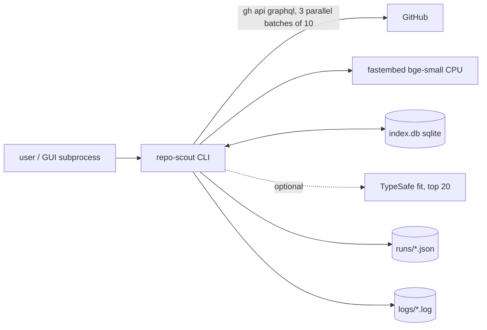

# System design: repo-scout

Reviewed 2026-11-05, existing-system mode. Flow, steps, failure table: [logic-map.md](logic-map.md). Not repeated here.

## Assumptions and numbers

Kind: local one-shot CLI plus a localhost NiceGUI wrapper. No server, no DAU. One user, runs by hand.

| Number | Value | Label |
|---|---|---|
| Runs so far | 42 saved run JSONs, 61 log files, since 2026-10-11 (~25 days, ~1.7 runs/day) | measured (`~/.local/share/repo-scout/runs`, `~/.local/state/repo-scout/logs`) |
| Rows per run | mean 396, max 549 | measured (run JSONs) |
| Run duration | median 234 s, max 621 s (log first-to-last line) | measured (logs; includes 0 s aborted runs) |
| GraphQL points per run | median 45, max 87, mean 43.5 | measured (`GitHub: spent N` lines, 42 runs) |
| GitHub GraphQL budget | 5000/h (4410 left after last run) | measured (last log line) |
| Index | `index.db` 82 MB, 7273 repos, 161 verdicts, ~11 KB/repo (README stored, 384-d float32 vec = 1.5 KB of it) | measured (sqlite ro) |
| Index growth | ~3.3 MB/day, ~173 new repos per run | measured (82 MB / 25 d; 7273 / 42 runs) |
| Runs dir | 12 MB (~290 KB/run) | measured (`du`) |
| Logs | 480 KB total, cap 1 GiB | measured; cap from `repo_scout/log.py:18` |
| Model cache | 65 MB fastembed | measured (`du ~/.cache/repo-scout`) |
| Code | 3393 lines in `repo_scout/*.py` | measured (`wc`) |
| Growth x10 | 17 runs/day | assumed |

## 0. What exists

Python CLI, entry `cli._main` (see logic-map "Entry points"). Deps: `gh api graphql` subprocess (GitHub), local fastembed bge-small on CPU, stdlib sqlite3 (`index.py:46`) with numpy cosine, optional TypeSafe "fit" request (`systemone.py:47`), optional OpenAI-compatible draft (`llm.py:147`). GUI spawns the CLI as a subprocess. No cron, no daemon, no deploy beyond `install.sh`/PyPI. Rung today: **rung 0, single process on one laptop** (below the ladder's rung 1).

## 1. Requirements

One sentence: given a task and queries, return a ranked table of existing GitHub repos worth building on.

Functional (3): search + rank, remember repos and verdicts (Index), replay recorded snapshots for eval. Out of scope: multi-user, hosting, scheduled runs.

Non-functional (all assumed): latency a few minutes per run is fine (measured median 4 min); availability n/a (interactive); durability: verdicts must not be lost (161 rows of hand-written judgement), the Index is rebuildable from GitHub; consistency n/a (single writer); security: GitHub token lives in `gh`, LLM keys in `~/.config/repo-scout/.env` 0600, GUI bound to 127.0.0.1 with Host check; observability: per-run log files, `GitHub: spent N` points.

## 2. Napkin math

Run twice, treating a "request" as one search run. The script's app-tier line is meaningless for a CLI (it assumes a server); only storage and the verdict matter.

```
$ napkin.py --dau 1 --req-per-user 17 --peak 3 --server-rps 1 --object-kb 1900 --write-kb 1900 --response-kb 250 --retention-years 5
requests/day 17 (x10 of measured 1.7) ; peak 0.0 req/s
storage per day (x3 repl) 9.7MB ; per year 3.5GB ; after 5 years 17.7GB
verdict: rungs 1-2: one good VPS. Ship it.
```

The x3 is replication; one copy is ~3.2 MB/day, matching the measured 3.3 MB/day. At x1 that is ~1.2 GB/year of Index. Other arithmetic (python3, not napkin):

```
GraphQL budget: 5000 pts/h / 87 pts (worst run)  = 57 runs/h ; / 45 (median) = 111 runs/h
Index vectors loaded by Index.top: 7273 x 384 x 4 B = 11.2 MB ; at 100k repos = 153.6 MB
```

Verdict: the numbers need nothing beyond the laptop. The limits are GitHub points and run latency, not DB or CPU.

## 3. API contract

n/a. CLI flags are in logic-map "Entry points". The only machine contract is the run JSON (`runs.py::save`) read by the GUI.

## 4. Architecture



Every box is already justified: GitHub is the data source; embedding is local to avoid per-call cost and a network dependency (offline after the first download); the Index gives cross-run memory (step 3 of the flow) and verdicts; run JSON feeds the GUI. TypeSafe is optional and off without a key. A queue, cache service or server is not needed: 1.7 runs/day.

## 5. Data

SQLite via stdlib, 2 tables: `repos` (display_name key, README, 384-d float32 BLOB `vec`, `model`, `fetched_at`) and `verdicts` (161 rows). Access pattern: one full scan per run (`index.py:79-86`: select all vecs, stack, cosine, argsort) plus ~173 upserts and a few deletes. A linear scan of 11 MB is milliseconds-to-tens-of-ms; an ANN index or vector extension would be a box with no number behind it. Keep sqlite. No cache layer: the GitHub round trip and the model are the cost, and `--record/--replay` already serve as a snapshot cache for eval only. A model change re-embeds all rows (logic-map "What a run writes"): at 7273 rows on CPU that is a one-off of minutes (assumed, not timed).

## 6. Scale and failure

x10 (17 runs/day): GitHub points 17 x 87 = 1.5k/day, far under 5000/h. Index grows to ~33 MB/day, 12 GB/year, and `Index.top` vectors reach 100k rows in about 1.5 months: 154 MB RAM per run and a ~100 MB read, still fine. What breaks first at x10 is **disk, not compute**: README text is stored for every repo ever seen (96% of the 11 KB row), never expired. Second: concurrent runs. `sqlite3.connect(path)` uses defaults (`index.py:46`, 5 s lock timeout, no WAL), and the GUI can start several subprocess runs that all write the Index; a second writer waits and can raise "database is locked". Measured so far: no evidence it happened, since 1.7 runs/day rarely overlap (assumed).

Failure behaviour:
- `gh` down or rate-limited: retries 5/10/20 s then exit 1; partial Index writes stay (logic-map "How it fails").
- Slow upstream (8 s TypeSafe or LLM): urllib has `timeout=TIMEOUT_S`; failure is a warning, table still prints. `run_gh` has **no timeout** (`github.py:54`): a hung `gh` hangs the run forever.
- Machine gone: Index is rebuildable except verdicts (161 rows). No backup is configured (assumed, none found in repo or cron).
- Retries have backoff only for rate limit; no circuit breaker (n/a, one caller).

## 7. Trade-offs

- Local embedding vs hosted API: costs CPU time and a 65 MB model, gains zero marginal cost and offline use.
- Store README in the Index: enables re-embedding on a model change without refetching; costs 11 KB/row and unbounded growth.
- `gh` subprocess instead of an HTTP client: reuses the user's auth, costs a process per call and no timeout control.
- Linear scan instead of ANN: simplest; fine below ~1M rows (assumed, 1.5 GB of vectors).
- Verdicts live next to a rebuildable cache in one file: one file to back up, but a corrupt or deleted Index loses the irreplaceable part.

## 8. Summary

Design: a single-process CLI with sqlite memory and local embeddings; it holds its real load (1.7 runs/day) with three orders of magnitude of headroom on GitHub points, CPU and DB. First bottleneck at x10 is disk growth of `index.db` (README storage, ~33 MB/day), then SQLite write contention from parallel GUI runs. Next rung: none needed in the ladder sense; next hardening step is trimming or compressing README text in `index.db` when it passes ~1 GB (about 10 months at today's rate, 1.5 months at x10), and WAL plus `timeout=` when the GUI is used for parallel runs.

Assumptions that would change it: multi-user use (needs a real DB and a token pool), scheduled unattended runs (needs the `gh` timeout and a backup), more than ~1M Index rows (needs ANN).

## Risks

- ✅ 2026-11-05 (`gh` timeout 60 s, retried as 504; not committed) MEDIUM, `repo_scout/github.py:54`: `subprocess.run` for `gh` has no timeout; a stalled network or `gh` process hangs the whole run, and the GUI run pool never frees the slot.
- ✅ 2026-11-05 (WAL + 30 s busy timeout; not committed) MEDIUM, `repo_scout/index.py:46`: default `sqlite3.connect` (no WAL, default 5 s busy timeout) with multiple writers possible from GUI-spawned parallel runs; "database is locked" would abort a run mid-upsert.
- MEDIUM, `index.db` schema (`index.py:16`): verdicts (irreplaceable) share a file with the rebuildable cache, no backup found; losing the file loses 161 verdicts.
- LOW, `repo_scout/index.py:16`: README stored per repo with no expiry; 82 MB at 7273 rows, ~96% README text; grows ~3.3 MB/day.
- LOW, `repo_scout/index.py:79-86`: full-table scan per run; fine until ~1M rows (11 MB now, 154 MB at 100k).
- LOW, step 6 retry design (logic-map "How it fails"): rate limit stops the run with exit 1 after 35 s of waiting; at 87 pts/run worst case this is only reachable by running >57 searches/h, so not a real risk today.
